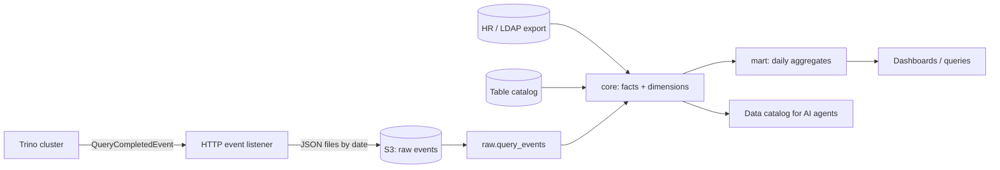

# Trino Usage Meta DWH

A small data warehouse that records how Trino users query Apache Iceberg tables, so we can answer
questions like *"How many distinct users queried table X?"* and *"How many resources did team Y use?"*,
and track how this changes over time.

Runs locally with **Python + DuckDB** on generated sample data. The SQL is written to translate directly to
**Trino + Iceberg** in production (see [Production setup](#production-setup)).

## Quick start

```bash
pip install -r requirements.txt

python generator/generate_events.py      # 1. generate 30 days of sample Trino query events
python pipeline/init_db.py --reset       # 2. create schemas and tables
python pipeline/run.py --all             # 3. load raw -> core -> mart
python pipeline/run_checks.py            # 4. data quality checks
python pipeline/run_queries.py           # 5. example queries answering the questions
python pipeline/build_data_catalog.py    # 6. extra: usage-enriched data catalog
```

Expected row counts after step 3: `raw.query_events` 5954, `core.fact_query` 5921,
`core.fact_query_table_access` 8018, `mart.agg_table_usage_daily` 479, `mart.agg_team_usage_daily` 172.

## Architecture



**Source.** `system.runtime.queries` only keeps recent queries in memory, so it cannot provide history.
Instead, Trino's **event listener** emits a `QueryCompletedEvent` for every query (user, source,
tables read, CPU, memory, bytes, failure info). We assume it is written as JSON to S3, one folder per day.

**Three layers:**

| Layer | Purpose |
|---|---|
| `raw` | Events exactly as received, including source duplicates. Source of truth for rebuilds and backfills. |
| `core` | Clean, deduplicated facts and dimensions, with team resolved at query time. |
| `mart` | Daily aggregates for fast dashboards and trend analysis. |

## Data model

Full column-level documentation: [`docs/data_model.md`](docs/data_model.md).

| Table | Grain | Notes |
|---|---|---|
| `raw.query_events` | 1 row per event received | `ingest_date` = arrival date (can differ from query date) |
| `core.fact_query` | 1 row per query | Resource metrics; `team_id` = team on the query date |
| `core.fact_query_table_access` | 1 row per query × table | Tables read; CPU split per table |
| `core.dim_user` | 1 row per user | `is_service_account` flag |
| `core.dim_team` | 1 row per team | Includes `unassigned` |
| `core.bridge_user_team` | 1 row per user × team × period | SCD Type 2 (`valid_from` / `valid_to`) |
| `core.dim_table` | 1 row per Iceberg table | Owner team, description |
| `mart.agg_table_usage_daily` | 1 row per table × day | Queries, distinct users/teams, bytes, CPU |
| `mart.agg_team_usage_daily` | 1 row per team × day | Queries, failures, CPU, bytes, memory |

Primary keys enforce each grain, so a bug that would duplicate rows fails loudly instead of silently
inflating numbers.

### Key design decisions

**1. Two fact tables, because there are two grains.** One query can read several tables. Keeping
"per query" metrics and "per query × table" access in separate tables means resource totals are never
multiplied by the number of tables read.

**2. Multi-table queries.**
- *Usage counts:* the query counts once for **each** table it read.
- *Resources:* query CPU is split across its tables by **share of bytes read** (equal split if bytes are
  unknown). The split always adds up to the query's CPU, which is verified by a data quality check.
- *Team totals:* always taken from `fact_query`, one row per query.

**3. Team attribution at query time (SCD Type 2).** A user's team history is stored with validity
dates. During loading, each query is joined to the team the user belonged to **on the query date**,
and the result is stored in the fact row. History stays correct after a user changes teams.
In the sample data, `prem` moves from analytics to marketing on 2026-10-16, and his queries are
charged to the correct team on each side of that date.

**4. Unknown users are kept.** Users missing from HR data get team `unassigned` instead of being
dropped, so totals stay complete and the gap is visible (reported as a data quality warning).

**5. Distinct counts are not additive.** Daily `distinct_users` in the marts must not be summed across
days. Period-level distinct counts are computed from the detail table. Example query 1 shows both: for
`iceberg.sales.orders` on Oct 1–15 the correct answer is **28** users, while summing daily values gives **157**.

## Resource metrics

| Metric | Meaning | Why |
|---|---|---|
| `cpu_time_ms` | Total CPU time across all workers | **Primary cost metric**: reflects real cluster work, independent of parallelism |
| `wall_time_ms` | Elapsed time | User-facing latency |
| `queued_time_ms` | Time waiting for resources | Signals cluster contention |
| `peak_memory_bytes` | Maximum memory at any moment | Memory pressure, risk of failures |
| `cumulative_memory_gb_sec` | Memory × time | Fair memory cost: 10 GB for 1 s ≠ 10 GB for 1 h |
| `physical_input_bytes` | Bytes read from storage | Scan cost, S3 request and I/O load |

Failed queries are kept and flagged: they still consumed resources. With a price per CPU-hour,
CPU time converts directly into team cost (chargeback).

## How data is updated

**Daily incremental run** (`run.py --date D`) processes query dates **D-3 … D**:

1. **Dimensions** are fully refreshed from the HR export and table catalog (small tables).
2. **Raw**: each S3 folder in the window is reloaded (delete that `ingest_date`, then insert).
3. **Core**: events are read from raw folders up to 3 days after the window, so late events are included;
   **deduplicated** by `query_id` (the event listener can deliver an event twice on retry); teams resolved.
4. **Marts** are rebuilt for the same dates.

**Why reprocess 3 days?** Events can arrive late. Re-running a short window lets the next runs pick
them up automatically. The window is a setting (`LOOKBACK_DAYS`); in production I would size it from
the observed delay distribution.

**Idempotent.** Every step deletes its date range before inserting, and the run is one transaction
(all or nothing). Running any date range any number of times gives the same result. Verified by
re-running `--all`, `--date` and a backfill: row counts stay identical.

**Backfills.** `run.py --start 2026-10-01 --end 2026-10-19` rebuilds any range from raw: after a logic
change, a bug fix, very late data, or corrected HR history. Raw is never modified, so history can always
be recalculated.

## Answering the questions

All queries are in [`sql/queries/`](sql/queries) and run with `python pipeline/run_queries.py`.

**Q1: How many distinct users queried table X during a period?**
```sql
SELECT COUNT(DISTINCT user_name)
FROM core.fact_query_table_access
WHERE table_id = 'iceberg.sales.orders'
  AND query_date BETWEEN DATE '2026-10-01' AND DATE '2026-10-15';
-- 28 users (25 known human users, 6 teams, 218 queries)
```

**Q2: How many resources did team Y consume during a period?**
```sql
SELECT SUM(query_count)                      AS queries,
       ROUND(SUM(cpu_time_ms) / 3600000.0, 2) AS cpu_hours,
       ROUND(SUM(bytes_read) / POWER(1024, 3), 1) AS gb_read
FROM mart.agg_team_usage_daily
WHERE team_id = 'analytics'
  AND usage_date BETWEEN DATE '2026-10-01' AND DATE '2026-10-15';
-- 677 queries, 2.64 CPU hours, 387.1 GB read
```
Additive metrics come from the daily mart (fast); distinct users come from `core.fact_query`.

**More examples:** each team's share of cluster CPU and failure rate (`03`), weekly trend with
week-over-week change (`04`), top 3 tables per team by CPU (`05`), cold tables (`06`).

## Data quality checks

`python pipeline/run_checks.py` runs 9 checks ([`sql/checks/data_quality.sql`](sql/checks/data_quality.sql))
and exits with code 1 on any failure, so an orchestrator would fail the run before bad numbers reach
dashboards.

- **FAIL checks:** no duplicate queries; every raw query reaches `fact_query`; CPU split adds up to query CPU;
  marts match core; no overlapping team periods per user; no negative metrics.
- **WARN checks:** users missing from HR data; queried tables missing from the catalog.

Current result: 8/9 pass, 1 expected warning (`contractor_x`, a user deliberately missing from HR data).

## Sample data and planted test cases

`generator/generate_events.py` produces events shaped like Trino's `QueryCompletedEvent` (simplified:
durations in milliseconds) with a fixed seed, so results are reproducible. Coming from a software
testing background, I designed the data with known edge cases so each rule can be verified, not assumed:

| Planted case | Verified result |
|---|---|
| User changes team mid-month | Queries charged to the correct team before/after |
| Multi-table queries | CPU split adds up exactly, no double counting |
| Duplicate event delivery (33 events) | Removed: 5954 raw events → 5921 queries |
| Late events (56) | Assigned to the correct day |
| User missing from HR data | Kept as `unassigned`, reported as a warning |
| Failed queries (5%) | Kept and flagged |
| Queries on system tables | Excluded from table usage |
| Table never queried | Detected as cold |

## Extras

**Cold tables** (`sql/queries/06_cold_tables.sql`): tables in the catalog with no queries in the last 30
days, which are candidates for archiving to save storage cost.

**Usage-enriched data catalog for AI agents** (`pipeline/build_data_catalog.py` →
[`docs/data_catalog.md`](docs/data_catalog.md), [`docs/data_catalog.json`](docs/data_catalog.json)).
An agent choosing a table needs more than its name. For every table, the catalog combines metadata with
usage signals: description, owner, popularity rank, distinct users, teams using it, last query date,
active/cold status, and **tables it is most often queried with** (join hints). The JSON form can be
served to an agent directly, for example through an MCP server.

## Additional metadata required

| Metadata | Structure | Used for |
|---|---|---|
| HR / LDAP export | `user_name, team_id, valid_from, valid_to` (daily snapshot or change log) | User → team mapping with history |
| User attributes | `user_name, email, is_service_account` | Separating humans from service accounts |
| Service account ownership | `account, owner_team_id` | Charging automated workloads to a team |
| Table catalog | `table_id, owner_team_id, description` (from Iceberg properties or a catalog tool) | Ownership, cold tables, AI catalog |
| Cost rates (optional) | `price_per_cpu_hour, price_per_tb_scanned` | Converting usage into cost |

## Assumptions

Full list: [`docs/assumptions.md`](docs/assumptions.md). The most important:
UTC time, a query belongs to the date of its end time; one team per user at a time; queries are charged
to the team at query time; service accounts belong to an owning team; failed queries are counted as cost;
system and `information_schema` tables are excluded; events can arrive up to 3 days late and can be
delivered more than once.

## Production setup

How this would run on the real stack:

- **Storage:** core and mart tables as Iceberg tables, partitioned by date
  (shown as comments in `sql/ddl/`). Queries for a date range only read those days.
- **Updates:** the same "delete the date range, then insert" pattern works in Trino on Iceberg.
- **Orchestration:** a daily Airflow job runs the same steps as `run.py`, in order:
  load dimensions → load raw → facts → marts → data quality checks.
  If a check fails, the run stops before bad data reaches dashboards.
- **Backfills:** the same steps run over any date range, as with `run.py --start --end`.

## Limitations and next steps

- **Column-level usage:** usage is tracked per table. Tracking per column
  (grain: query × table × column) would show which columns are never used.
- **Write queries:** only reads are attributed. Queries that write data
  (INSERT, CREATE TABLE AS) could be added using the event's output metadata.
- **Storage cost:** only query cost is measured. Adding table sizes from Iceberg
  metadata would show storage cost too.
- **Very late events:** events arriving after the 3-day lookback need a manual backfill.

## Project structure

```
generator/generate_events.py   sample Trino events + reference data
sql/ddl/                       table definitions (raw, core, mart)
sql/transform/                 load and transformation SQL
sql/queries/                   example queries
sql/checks/                    data quality checks
pipeline/                      init_db, run, run_checks, run_queries, build_data_catalog
docs/                          data model, assumptions, data catalog
```