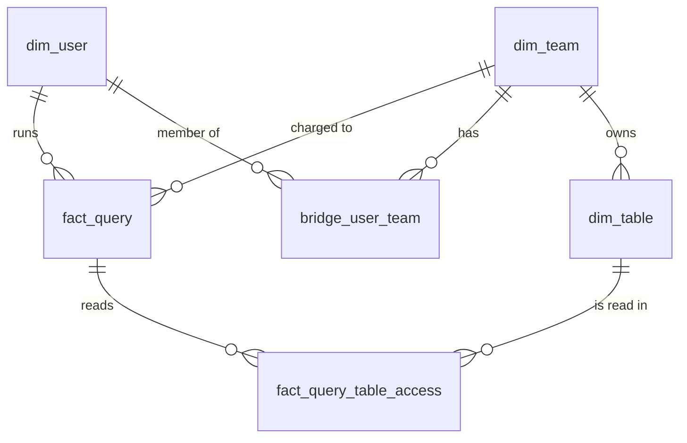

# Data Model

## Overview

The model has 3 layers:

1. **Raw**: exact copy of Trino query events, kept for reprocessing and backfills.
2. **Core**: fact tables (queries, table accesses) and dimension tables (users, teams, tables).
3. **Marts**: daily aggregates for dashboards and trend analysis.

## Layer 1: Raw

### raw_query_events
**Grain:** 1 row per event received.

| Column | Description |
|---|---|
| event_id | unique id of the received event |
| query_id | Trino query id |
| payload | full QueryCompletedEvent as JSON |
| event_date | date partition (UTC, from query end time) |
| loaded_at | when the row was loaded |

Purpose: source of truth. If transformation logic changes, all core and mart tables can be rebuilt from here.

## Layer 2: Core

### fact_query
**Grain:** 1 row per query.

| Column | Description |
|---|---|
| query_id (PK) | Trino query id |
| query_date | date of query end time (UTC) |
| user_name | user who ran the query |
| team_id | user's team at query time |
| source | client tool (jupyter, superset, airflow, ...) |
| query_state | FINISHED / FAILED |
| start_time, end_time | query timestamps |
| cpu_time_ms | total CPU time |
| wall_time_ms | elapsed time |
| queued_time_ms | time waiting in queue |
| peak_memory_bytes | peak memory used |
| cumulative_memory_gb_sec | memory multiplied by time |
| physical_input_bytes | bytes read from storage |
| tables_read_count | number of tables read |

### fact_query_table_access
**Grain:** 1 row per query × table read.

| Column | Description |
|---|---|
| query_id | Trino query id |
| table_id | catalog.schema.table |
| query_date | date of query end time (UTC) |
| user_name | user who ran the query |
| team_id | user's team at query time |
| bytes_read | bytes read from this table |
| columns_read_count | number of columns read |
| bytes_share | this table's share of the query's bytes (0–1) |
| cpu_time_allocated_ms | query CPU × bytes_share |

### dim_team
**Grain:** 1 row per team.
Columns: team_id (PK), team_name, department

### dim_user
**Grain:** 1 row per user.
Columns: user_name (PK), email, is_service_account, first_seen_date

### bridge_user_team (SCD Type 2)
**Grain:** 1 row per user × team × validity period.

| Column | Description |
|---|---|
| user_name | user |
| team_id | team |
| valid_from | start date of membership |
| valid_to | end date (NULL = current) |

### dim_table
**Grain:** 1 row per Iceberg table.
Columns: table_id (PK), catalog, schema_name, table_name, owner_team_id, description, created_date

## Layer 3: Marts

### agg_table_usage_daily
**Grain:** 1 row per table × day.
Columns: usage_date, table_id, query_count, distinct_users, distinct_teams, bytes_read, cpu_time_allocated_ms

### agg_team_usage_daily
**Grain:** 1 row per team × day.
Columns: usage_date, team_id, query_count, failed_query_count, distinct_users, cpu_time_ms, bytes_read, cumulative_memory_gb_sec

## Important notes

- **Team is resolved at load time.** team_id is looked up from bridge_user_team using the query date and stored in the fact tables. History stays correct when users change teams.
- **No double counting.** Team resource totals come from fact_query (1 row per query), never from summing fact_query_table_access.
- **Distinct counts are not additive.** distinct_users in daily aggregates cannot be summed across days. For distinct users over a period, query fact_query_table_access directly.

## ER Diagram

